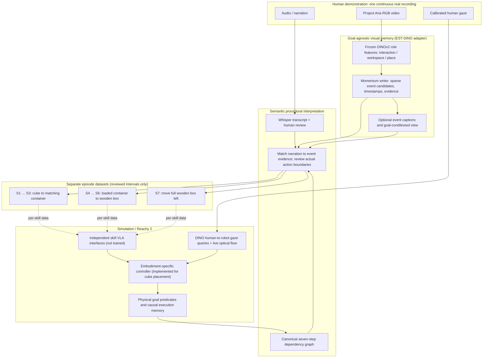
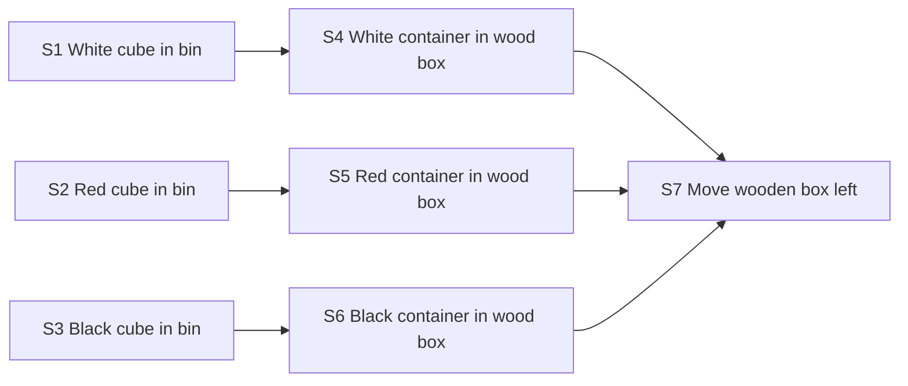

# From continuous Aria demonstration to independent robot-skill episodes

This describes the **implemented interfaces** in Ego2Robot and the proposed
training direction. It is both a research explanation and an executable data
contract. The existing motor controller has **not** been replaced by a VLA, and
no seven-skill policy training result is claimed.

## Two representations, two clocks



**Human and robot clocks are separate.** Narration and gaze times index the
human video. A verified robot grasp changes active gaze phase during robot
execution; human times do not schedule robot motor actions.

**Proposed episode windows** are formed from the union of actual visual
events that overlap a narration mention. The manifest records these as
`proposed_visual_window_s`, explicitly labeled **NOT VERIFIED**.
An actual skill clip is emitted only after a person validates its
`start_s` and `end_s` in the recorded RGB timeline. Where the optional
goal-conditioned event view is available, excluded and uncertain event IDs
are reported separately while all original events remain recoverable.

**Visual events are not step labels.** The WACV memory writer proposes sparse
visual events from role-conditioned frozen DINO features and momentum. It
retains all episodic evidence, including interruptions. The semantic layer
interprets candidate events using narration, captions when available, and
canonical task goals. A reviewer then confirms intervals before they become
trainable *human video clips*. One step can span several visual events.

## Minimal canonical graph



**There is no S3 → S7 direct edge.** It is transitive via S6. All other
direct dependencies are in [configs/procedure_graph.json](configs/procedure_graph.json).
The Python source is `Ego2Robot_scene/procedure_graph.py`, and regression tests
check that its JSON representation remains identical.

## Machine-readable contracts

| Artifact | Contract and interpretation |
|---|---|
| `configs/multimodal_architecture.json` | Modalities, pipeline stages, statuses, and directed links |
| `configs/procedure_graph.json` | Seven canonical steps, preconditions, physical postconditions |
| `<demo>_full_plan.json` | Actual narration step mentions and optional observed gaze evidence |
| `fine_events.json` (external) | Actual DINO visual event intervals and provenance |
| `episode_manifest.json` | All visual events, tentative semantic matches, human-reviewed episodes |
| `training_units.json` | One VLA data group **per canonical step**, no fabricated checkpoints |
| `procedural_memory.json` | Live robot verification and state reconciliation (existing) |

The new adapter is `Ego2Robot_scene/episode_pipeline.py`. It accepts WACV
EST-DINO-style `events` or `fine_events` arrays, with
`event_id`, `start_seconds`, `end_seconds`, `boundary_method`,
optional `parent_context_id`, `role_evidence`, `evidence`,
`caption`, and `goal_conditioned_view`. Events without declared
boundary-method provenance remain marked `unverified_external_events` - they
are **not** silently relabeled DINO results.

## Run on your personally collected video

**1.** Extract real narrated actions, all seven goal definitions, and an
initial (unverified) episode-review queue:

```bash
python Ego2Robot_scene/full_procedure.py \
  --video /mnt/4TBSSD/Ego2Robot_Humanoid/data/Full_Procedure/mp4_480/cda03c03-68c9-4caf-9deb-5a5fa091ab0e_480.mp4 \
  --demo-id cda03c03-68c9-4caf-9deb-5a5fa091ab0e \
  --asr --out outputs/full_procedure
```

This produces `episodes/episode_manifest.json` with **narration candidates**,
not confirmed action boundaries. The real video is private; it is not stored
in the GitHub repository and has not been processed by GitHub Actions.

**2.** Run the separate WACV EST-DINO memory writer on that actual RGB video
using the WACV project's documented frozen DINO feature extraction and
momentum event segmentation. This project **does not** impersonate that
separate repository or recompute its DINO features. Export the real
`fine_events.json` or machine-actionable event memory JSON.

The handover describes the upstream sequence as: frozen DINOv2 features →
role-conditioned interaction/workspace/place streams → momentum event writer
→ timestamped events and evidence packets → optional event-level captioning
and nondestructive goal-conditioned consolidation. **This is a sparse event
memory writer, not a dense action-segmentation oracle.**

**3.** Inspect the actual event boundaries in the recording; associate them
with the narrated step semantics. Copy
[configs/reviewed_alignments_template.json](configs/reviewed_alignments_template.json)
and populate `demo_id` plus actual reviewed intervals:

```json
{
  "demo_id": "cda03c03-68c9-4caf-9deb-5a5fa091ab0e",
  "alignments": []
}
```

Each real row to add must contain `step_id` (S1-S7),
`start_s` and `end_s` measured on the human video timeline,
`status: "reviewed"`, `reviewed_by`, and optionally
`event_ids`. No example/fabricated timing is included here.
Missing/skipped steps have **no invented intervals or clips**.

**4.** Build the per-step episode dataset and export actual video clips:

```bash
python Ego2Robot_scene/episode_pipeline.py \
  --plan outputs/full_procedure/cda03c03-68c9-4caf-9deb-5a5fa091ab0e_full_plan.json \
  --dino-events /path/to/real/fine_events.json \
  --reviewed-alignments /path/to/reviewed_alignments.json \
  --export-clips --out outputs/skill_episodes
```

Only reviewed episodes are exported. Each is cropped from the **same original
human recording**, with no alteration to gaze or action timing. If there is no
reviewed action, there is no "training clip." Real DINO event identities and
other nonprocedural visual events remain preserved in `episode_manifest.json`.

Alternatively, pass `--dino-events`, `--reviewed-alignments`, and
`--export-episode-clips` to `full_procedure.py` to build these artifacts
in the same run as narration extraction.

## Per-skill VLA training interface

`training_units.json` lists **seven independent skill datasets** even if only
one action has been reviewed. For each unit it retains the language goal,
object, destination, step graph prerequisites, episode references and a
`policy_checkpoint: null`. A reviewed human clip is an **observation of a
human demonstration**, not a robot action trajectory.

The intended next training stage is one policy/adapter per skill,
conditioned on the corresponding human-derived event, language and gaze
information, **plus appropriate robot action supervision or an explicitly
specified cross-embodiment adaptation mechanism**. Egocentric RGB and
narration alone cannot be relabeled as Panda/Reachy joint actions.

After training, a high-level graph planner would select an enabled skill,
invoke its VLA in simulation and verify its postcondition before proceeding.
The current Reachy controller uses MuJoCo and Jacobian IK for cube placement;
the loaded-container and final pushing skills are not yet physically
implemented. The graph, event memory and clip interfaces do not make those
physical skills complete.

## Tests and provenance

```bash
python -m unittest discover -s tests -p 'test_episode_pipeline.py' -v
python -m unittest discover -s tests -p 'test_*.py' -v
```

All tests use **synthetic interface fixtures only**, including any test
timestamps and mocked episode IDs. They validate serialization, evidence
provenance, exact S7 prerequisites, reviewed-interval safeguards, and
untrained-policy status - not segmentation accuracy, robotic policy accuracy,
or real-video grounding.

**Design choices:** preserve full episodic history; do not force one DINO
event to equal one skill; separate speech semantics from visual change;
separate demonstration preparation from actual VLA training; and gate
robot memory completion on observations rather than instructions.
