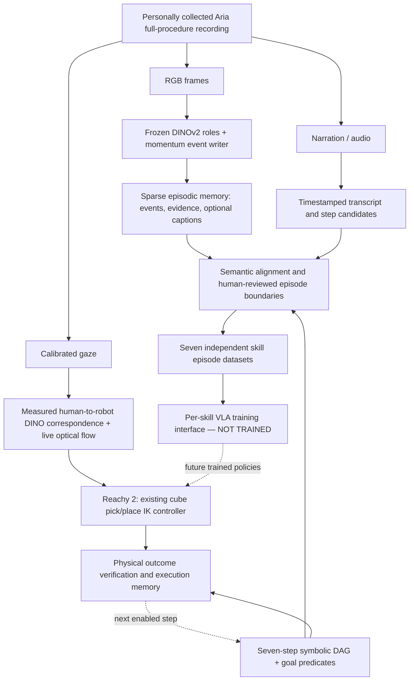

# Ego2Robot

**Gaze-grounded procedural transfer from human egocentric demonstrations to a simulated humanoid manipulator.**

A lightweight, reproducible Humanoid internship research challenge prototype. Research question: **can a humanoid execute a multi-step task by transferring human-derived object/goal correspondence and procedure, while retaining a small embodiment-specific motor controller and explicit task-state memory?**

## Full seven-step egocentric procedure and symbolic memory

See [FULL_PROCEDURE.md](FULL_PROCEDURE.md): one-command real MP4 narration
extraction, the user-verified seven-step causal graph, optional measured
gaze evidence and persistent execution-memory reconciliation. The DAG and
gaze queries drive procedural decisions independently of robot time.
Only cube-to-bin motor skills are currently implemented; a seven-step
physical rollout is **not** claimed.

The new [multimodal episode pipeline](MULTIMODAL_EPISODES.md) connects the
full recording to DINO-momentum event evidence, human-reviewed step episodes,
and **separate, not-yet-trained** VLA data groups for all seven goals.

## Live, phase-aware robot visual tracking

**Implemented:** two measured Aria gaze-derived DINOv2 query descriptors
(source + destination), continuous Reachy head-camera pyramidal Lucas–Kanade
tracking with optional DINOv2 re-anchoring, and an event-driven attention
switch **only after verified physical stable grasp**. Human and robot
timelines are independent. Tracks and annotated robot-camera MP4 are saved
during physical execution. The motor policy still queries privileged
MuJoCo object geometry; this is not vision-only motor control.

See **[LIVE_PHASE_TRACKING.md](LIVE_PHASE_TRACKING.md)** for the exact real
Aria → robot execution command, outputs, and evidence boundaries.

## Real Aria gaze to Reachy head-camera correspondence

The key experiment now has a runnable DINOv2 feature matcher, synchronized
gaze CSV input, head-camera image and MuJoCo oracle object-mask exporter.
See [GAZE_CORRESPONDENCE.md](GAZE_CORRESPONDENCE.md) for commands and the
real input paths. Do not use a gaze-circle overlay RGB for reliable DINO
matching. Correspondence on the real capture remains to be validated.

## Time-boxed first-step Aria-to-Reachy demo

**Execution scope: white cube -> white bin only.** The original physical
simulation succeeds, but the full seven-step sequence and learned real-data
transfer are not yet experimentally verified.

The runnable input/grounding/robot integration, optional real-data V-JEPA 2
video feature extractor, trainable state probe, and trainable verb/object
feature-pack builder are now documented in [DEMO_PIPELINE.md](DEMO_PIPELINE.md).

Do not confuse synthetic interface checks with validated Aria observations.

## Architecture: continuous egocentric video to skill-level episodes



**Why separate events from steps?** The WACV EST-DINO momentum writer produces
sparse goal-agnostic visual events, *not* seven magically recovered action
segments. Narration and optional event captions supply semantic evidence.
Reviewed alignments connect one or more visual events to a canonical skill;
only those measured action intervals become standalone MP4 episodes. This
preserves excluded/uncertain events in the episodic record instead of deleting
them or assigning fabricated labels.

**Train separately per skill:** each S1–S7 has its own machine-readable dataset
group in `training_units.json`, suitable for later embodiment-specific VLA
fine-tuning. The current implementation **prepares episode manifests/clips**
but does not train a VLA or manufacture robot action targets from human RGB.
Reachy's verified cube pick/place still uses physical MuJoCo + IK. Robot gaze
uses visual correspondence and robot-phase gating, not human timestamp replay.

**Machine-readable sources:** [configs/procedure_graph.json](configs/procedure_graph.json)
and [configs/multimodal_architecture.json](configs/multimodal_architecture.json).
**Full technical walkthrough and commands:** [MULTIMODAL_EPISODES.md](MULTIMODAL_EPISODES.md).

Quick handoff from the already extracted real full plan:

```bash
python Ego2Robot_scene/episode_pipeline.py \
  --plan outputs/full_procedure/<real_demo_id>_full_plan.json \
  --dino-events /path/to/actual/fine_events.json \
  --out outputs/skill_episodes
```

Without human-reviewed boundaries, this emits an auditable **review queue and
untrained per-skill manifests only**. Add `--reviewed-alignments` and
`--export-clips` once actual action intervals have been checked.

## Verified results (October 16, 2026)

The scene, fixed-base robot and actuators compile and run on the user's Debian computer. A [GitHub Actions CPU MuJoCo rollout](https://github.com/Robotics-Imitation-Learning/ego2robot/actions) independently verifies a **physical white-cube → white-bin pick-and-place**, including:

- Seven-joint right-arm IK and actuator-driven motion;
- Contact-based grasp using Reachy's official gripper, adapted with **3 mm simulated fingertip sleeves**;
- Approximately **13 cm stable cube lift**, held for an extra second with bilateral finger contact;
- Physical transport, release and cube-in-bin verification from live MuJoCo state (not a scripted object teleport);
- Grasp tip centre **10 mm above the cube centre** with a horizontal entry path.

A separate **compact right-arm layout** is IK-feasible for all three cubes; standalone red-cube physical placement has also succeeded with a narrower approach aperture. Black-cube grasp and uninterrupted three-cube execution remain under test.

**Not yet verified or claimed:** automatic real Aria gaze → simulated action grounding, full seven-step sequential execution, learned visual completion verification, or physical placement of the loaded bins into the wooden tray. The procedural completion checker currently uses privileged MuJoCo state (oracle). See [CHALLENGE.md](CHALLENGE.md).

## Quick start: physically verified white-cube operation

```bash
git clone https://github.com/Robotics-Imitation-Learning/ego2robot.git
cd ego2robot
python3 -m venv .ego2robot_venv
source .ego2robot_venv/bin/activate
pip install -r requirements.txt

git clone --depth 1 https://github.com/pollen-robotics/reachy2_mujoco_assets.git

# Reproducible physically dynamic cubes, bins and tray; fixed humanoid base.
python Ego2Robot_scene/challenge_scene.py --reachy-assets ./reachy2_mujoco_assets

# Optional NVIDIA offscreen rendering
export MUJOCO_GL=egl

python Ego2Robot_scene/pick_place.py \
  reachy2_mujoco_assets/scenes/ego2robot_challenge.xml \
  --mode execute --record
```

Output snapshots appear in `outputs/white_cube/` (ignored by Git). Successful execution prints `PASS: physical cube-in-bin predicate satisfied.`

For the compact, single-right-arm task layout, build a *separate* scene:

```bash
python Ego2Robot_scene/challenge_scene.py \
  --reachy-assets ./reachy2_mujoco_assets --layout compact

python Ego2Robot_scene/pick_place.py \
  reachy2_mujoco_assets/scenes/ego2robot_compact.xml \
  --object red_cube --mode execute \
  --grasp-style side --pinch-height 0.010 \
  --approach-open-angle 1.0 --record
```

The original challenge scene stays intact. The copied `ego2robot_reachy2_body.xml` contains the simulated pad modifications; the official downloaded robot asset is unchanged.

## Human demonstrations and procedural execution

See [RECORDING_PROTOCOL.md](RECORDING_PROTOCOL.md): record one pilot and two complete Aria seven-step demonstrations with changed cube order, using RGB, gaze, timestamps and narration; preserve the originals privately. Grounding and language training inputs are documented in [GROUNDING.md](GROUNDING.md).

The structured-plan runner `Ego2Robot_scene/execute_demo.py` uses a **single persistent MuJoCo scene** and checks current state before each specified action. At present its motor executor supports the **three cube-to-bin** steps; container-packing and tray-pushing are not implemented. The task plan must be extracted/verified from a **real recording** before this is evidence of human-driven behavior.

```bash
python Ego2Robot_scene/execute_demo.py \
  reachy2_mujoco_assets/scenes/ego2robot_compact.xml \
  --plan data/processed/my_recorded_demo_actions.json --max-steps 3 --record
```

`tests/fixtures/synthetic_plan.json` exists only for regression testing the code interface, **not** as applicant-collected data.

## Research choices and limitations

1. **Hierarchical task representation:** source, verb, destination, prerequisites and expected scene postconditions, independent of robot embodiment.
2. **Real gaze / frozen DINOv2:** use existing correspondence research rather than implementing an unvalidated pixel/colour matching substitute.
3. **Model-based action:** Cartesian/IK controller handles morphology and joint commands without H100 training; slight object shifts can be handled by querying the live scene.
4. **Procedural memory:** check current outcome and skip/repair incomplete goals rather than using a blind progress counter.
5. **Reproducible and honest results:** each claimed physical success is validated by MuJoCo contact and object state. Visually grounded verification is a separate, incomplete task.
6. **Gripper compatibility:** stock Reachy finger-collision geometry had insufficient purchase on the 30 mm cube. The 3 mm simulated sleeves are a **declared change to the physical gripper model**, not a VLA improvement.

See [CHALLENGE.md](CHALLENGE.md) for the seven goals, detailed limitations and follow-up work. Sources: [Reachy 2 MuJoCo assets](https://github.com/pollen-robotics/reachy2_mujoco_assets), [MuJoCo](https://mujoco.org/).
