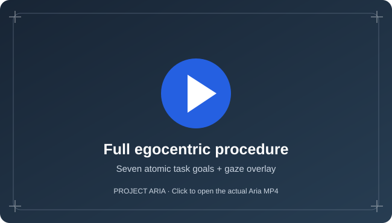
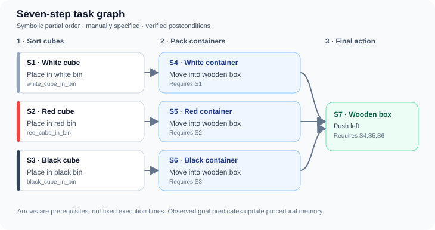
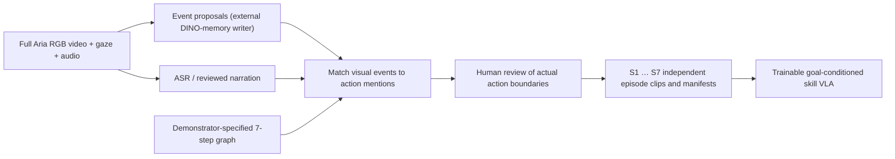
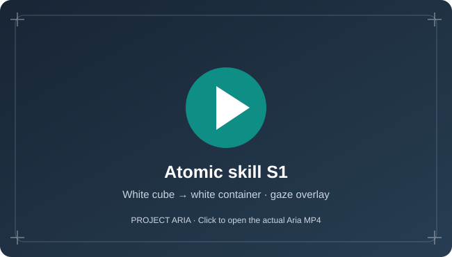
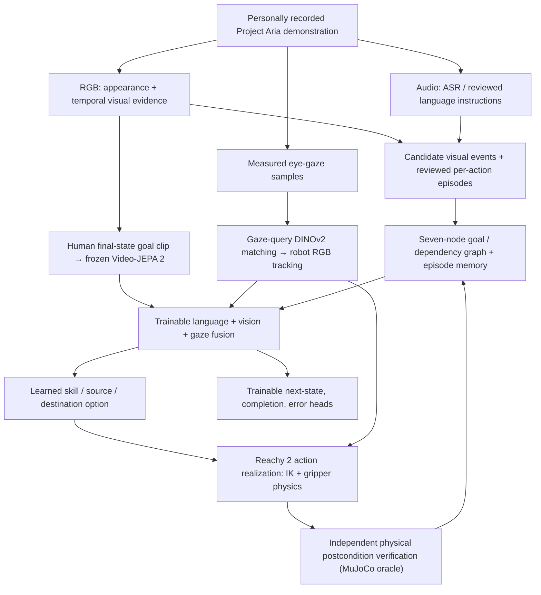

# Ego2Robot: Learning Robot Skills from Egocentric Human Demonstrations

**A reproducible research prototype connecting multimodal Project Aria demonstrations to procedural task graphs, visual correspondence, a trainable hierarchical vision–language–action (VLA) architecture, and physically verified Reachy 2 manipulation in MuJoCo.**

> **Research direction.** Could a person teach or adapt a robot by demonstrating a task once from their own first-person viewpoint? Human RGB, narration, and eye gaze provide complementary evidence about **what** to do, **which objects** matter, **where** to attend, and **what successful completion looks like**. We transfer this structured information to a different embodiment, then use the robot's own observations and physical state for execution and verification.

**What is demonstrated today:** applicant-recorded Aria video and gaze; seven-node symbolic task representation; interfaces for human-reviewed temporal segmentation; real DINOv2 gaze-to-robot correspondence and live Lucas–Kanade tracking; a trainable, goal-conditioned Video-JEPA 2 / language / gaze skill-option model; and a **verified white-cube → white-container physical rollout**. We do **not** claim end-to-end learning from one video, automatic seven-step execution, or robustness under distribution shift.

## 1. See the human demonstrations and task graph

### Complete egocentric procedure and its symbolic representation

One continuous first-person recording depicts the longer task. Its measured gaze overlay illustrates what the demonstrator attends to; the **seven-node task graph alongside it** encodes the canonical prerequisites and expected postconditions. Graph nodes are **demonstrator-specified and verified**, not automatically discovered from pixels.

<table>
<tr>
<th width="47%">Full procedure — Project Aria + measured gaze</th>
<th width="53%">Canonical seven-step causal task graph</th>
</tr>
<tr>
<td align="center" valign="top">
<a href="data/cda03c03-68c9-4caf-9deb-5a5fa091ab0e_480_gaze_red_circle.mp4"></a>
<p><strong><a href="data/cda03c03-68c9-4caf-9deb-5a5fa091ab0e_480_gaze_red_circle.mp4">▶ Watch the full-procedure video (MP4)</a></strong></p>
<p><sub>Real egocentric footage · visible gaze overlay</sub></p>
</td>
<td valign="top">
<a href="configs/procedure_graph.json"></a>
<p><strong><a href="configs/procedure_graph.json">Inspect the machine-readable task graph</a></strong></p>
<p><sub>Three independent cube operations → three prerequisite-dependent container placements → final leftward push. Prerequisites are a partial order, not a fixed motor timeline.</sub></p>
</td>
</tr>
</table>

The **clean RGB** source is also available: [full-procedure MP4](data/cda03c03-68c9-4caf-9deb-5a5fa091ab0e_480.mp4). The repository's [data directory](data/) includes the original exported MP4s, gaze projections, overlay MP4s, and Aria recording metadata. It does **not** contain the full raw VRS streams.

### Temporal segmentation: continuous recording → independent atomic skills

A continuous Aria recording is *not* seven robot training episodes by default. We distinguish **visual events** (candidate intervals from the external EST-DINO-style memory writer), **narrated action mentions** (ASR or reviewed transcript), and **verified atomic action intervals** (explicit human-reviewed boundaries). A single action can span multiple visual events.



**Implemented locally:** [`full_procedure.py`](Ego2Robot_scene/full_procedure.py) recognizes narrated canonical actions; [`episode_pipeline.py`](Ego2Robot_scene/episode_pipeline.py) ingests externally produced temporal events, builds an auditable alignment review queue, and exports separate clips **only with approved start/end times**. The external DINO-momentum *automatic boundary generator is not bundled*, and the seven graph edges are not learned automatically.

### A closer look: Step 1 — white cube into white container

<a href="data/19a5c812-520b-4f8f-89ee-9b7b0879ca23_480_gaze_red_circle.mp4"></a>

**[▶ Watch atomic Step 1 with measured gaze (MP4)](data/19a5c812-520b-4f8f-89ee-9b7b0879ca23_480_gaze_red_circle.mp4)** · [Clean Step 1 RGB recording](data/19a5c812-520b-4f8f-89ee-9b7b0879ca23.mp4) · [Step 1 gaze coordinates](data/19a5c812-520b-4f8f-89ee-9b7b0879ca23_gaze_xy.csv)

In this **single atomic skill**, human gaze attends to the **source cube**, then the **destination container**. DINOv2 transfers the two attended visual regions into the robot's head-camera view. **Robot execution is never synchronized to the human timestamps:** live robot optical flow tracks both targets, and a physically verified stable grasp triggers the source → destination attention switch.

## 2. End-to-end architecture: how the modalities are used



| Component | In the repository | What the evidence supports |
|---|---|---|
| **RGB + eye gaze** | [`data/`](data/), [`aria_ingest.py`](Ego2Robot_scene/aria_ingest.py) | Real exported Aria MP4s and gaze CSVs available; no hand-pose pipeline. |
| **Narration → tasks** | [`full_procedure.py`](Ego2Robot_scene/full_procedure.py) | Whisper interface + rule-based task mention extraction. ASR quality and full-recording transcripts are not benchmarked. |
| **Temporal segmentation** | [`episode_pipeline.py`](Ego2Robot_scene/episode_pipeline.py) | Event alignment/review and real per-step clip export implemented; external automatic visual boundary writer **not** included. |
| **Task graph and memory** | [`procedure_graph.py`](Ego2Robot_scene/procedure_graph.py), [graph JSON](configs/procedure_graph.json) | Seven canonical goals, prerequisites, and outcome-dependent state updates; graph authored from task specification. |
| **Human gaze → robot vision** | [`transfer_aria_gaze.py`](Ego2Robot_scene/transfer_aria_gaze.py), [`live_gaze_tracker.py`](Ego2Robot_scene/live_gaze_tracker.py) | DINOv2 patch correspondence + pyramidal Lucas–Kanade + optional live re-anchoring. Real Step 1 source/destination correspondences accepted; oracle object masks are used for offline correspondence labeling. |
| **Trainable hierarchical VLA** | [`trainable_vla.py`](Ego2Robot_scene/trainable_vla.py) | Learnable language/vision/gaze fusion and skill, target, completion, mistake, future-state heads; CPU training/inference contract passes. **No independent real-data accuracy established.** |
| **Video-JEPA 2** | [`vjepa2_encoder.py`](Ego2Robot_scene/vjepa2_encoder.py), [`make_vla_episode_pack.py`](Ego2Robot_scene/make_vla_episode_pack.py) | Frozen pretrained video features for observation and demonstrated terminal-state goal; completion/error heads trainable separately. Not a trained Video-JEPA 2 action/world model. |
| **Robot action and postconditions** | [`pick_place.py`](Ego2Robot_scene/pick_place.py), [`execute_demo.py`](Ego2Robot_scene/execute_demo.py) | Physical white-cube grasp, transport and placement verified in MuJoCo. IK still uses privileged object poses; remaining longer-horizon skills not demonstrated. |
| **Distribution-shift robustness** | Proposed evaluation | No measured robustness gains or randomized-benchmark success rate claimed. |

**Terminology:** the visual encoder is **Video-JEPA 2** (not VideoGPT-2). Language tokens are trainable in the hierarchical option model. Human gaze supplies cross-view semantic localization; it is **not** a direct learned 3-D object-pose estimator or the actual motor control signal.

## 3. What is novel in this prototype?

The research hypothesis is that a **person's first-person procedural demonstration** offers more than generic imitation frames: narration identifies *what*, gaze identifies *where*, the human terminal scene offers *what success looks like*, and the task graph records *which consequences matter*. We combine those sources into a **trainable skill-level VLA interface** that leaves embodiment-specific motor execution and verification explicit.

Crucially, **procedural time and motor time are separated**. Gaze descriptors select source/goal regions, Lucas–Kanade tracks those regions in *robot* frames, and Reachy's actual stable grasp changes active attention; there is no hand-designed timestamp replay. The learned model can be trained from actual observed robot pre/post states paired with a human goal clip, while physical success is checked separately. Novelty is an **architectural proposal**, not a demonstrated improvement over competing VLAs.

## 4. Reproduce the current implementation

### Run the physically verified Reachy 2 skill

```bash
git clone https://github.com/Robotics-Imitation-Learning/ego2robot.git
cd ego2robot
python3 -m venv .ego2robot_venv
source .ego2robot_venv/bin/activate
pip install -r requirements.txt
git clone --depth 1 https://github.com/pollen-robotics/reachy2_mujoco_assets.git
python Ego2Robot_scene/challenge_scene.py --reachy-assets ./reachy2_mujoco_assets
# For headless CPU rendering, use MUJOCO_GL=osmesa after installing OSMesa.
python Ego2Robot_scene/pick_place.py \
  reachy2_mujoco_assets/scenes/ego2robot_challenge.xml --mode execute --record
```

The controller drives Reachy's simulated arm and physically closes the gripper around a dynamic cube. Successful execution prints `PASS: physical cube-in-bin predicate satisfied.` The experiment explicitly adds **3 mm simulated fingertip sleeves** to improve grasp of the 30 mm cube; this is disclosed and not presented as a learned improvement.

### Inspect the complete recording and propose skill episodes

```bash
# Requires faster-whisper and a real audio track in the recorded MP4.
pip install faster-whisper
python Ego2Robot_scene/full_procedure.py \
  --video data/cda03c03-68c9-4caf-9deb-5a5fa091ab0e_480.mp4 \
  --demo-id cda03c03-68c9-4caf-9deb-5a5fa091ab0e \
  --asr --out outputs/full_procedure

# Emits review candidates and seven per-skill manifests; does not fabricate
# confirmed visual boundaries or substitute the task graph for evidence.
python Ego2Robot_scene/episode_pipeline.py \
  --plan outputs/full_procedure/cda03c03-68c9-4caf-9deb-5a5fa091ab0e_full_plan.json \
  --out outputs/skill_episodes
```

To use DINO event proposals, provide `--dino-events`; to emit video training clips, supply explicit `--reviewed-alignments` and `--export-clips` (FFmpeg required). Read [FULL_PROCEDURE.md](FULL_PROCEDURE.md) and [MULTIMODAL_EPISODES.md](MULTIMODAL_EPISODES.md) for the exact schemas.

### Train and inspect the learnable VLA

Read **[TRAINABLE_HIERARCHICAL_VLA.md](TRAINABLE_HIERARCHICAL_VLA.md)** for commands that encode a **real final human video clip** and clean Reachy before/after images with frozen Video-JEPA 2, reuse real DINO gaze descriptors, train the lightweight PyTorch cross-modal skill policy, and run fresh robot-view inference.

The repository also documents the [real gaze-to-robot pipeline](GAZE_CORRESPONDENCE.md), [live optical-flow and phase switching](LIVE_PHASE_TRACKING.md), and [per-step execution](DEMO_PIPELINE.md). Large pretrained weights and locally generated inference logs are not committed.

Run contract and regression tests:

```bash
python -m unittest discover -s tests -p 'test_*.py' -v
```

GitHub Actions runs [Aria/graph tests](https://github.com/Robotics-Imitation-Learning/ego2robot/actions/workflows/aria_integration.yml), [real physical MuJoCo simulation tests](https://github.com/Robotics-Imitation-Learning/ego2robot/actions/workflows/robot_physics.yml), [gaze-flow simulation tests](https://github.com/Robotics-Imitation-Learning/ego2robot/actions/workflows/live_tracking_physics.yml), and [PyTorch trainability tests](https://github.com/Robotics-Imitation-Learning/ego2robot/actions/workflows/trainable_vla.yml). Synthetic fixtures are for **interface regression**, not reported learned generalization accuracy.

## 5. Evidence, limitations, and next steps

**Confirmed physical result:** white cube placed into the white bin in the real Aria-grounded simulation run; independent MuJoCo postcondition returned `true`; verified stable grasp caused the robot attention switch at approximately **20.4 seconds of robot simulation time**. Additional standalone red/white cases have succeeded under documented initial conditions. See [RESULTS.md](RESULTS.md) for the earlier engineering rollout record.

**Not claimed:** full seven-step robot completion, autonomous task-graph discovery, automatic DINO boundary generation inside this repository, end-to-end learned continuous joint control, cross-view completion/error classifier accuracy, or distribution-shift improvements. The current code provides trainable components and an auditable experimental pathway to test those hypotheses.

The aim is a reusable human-to-robot skill acquisition interface: **demonstrate from the first person, structure the procedure, transfer human attention and goal appearance, learn the appropriate skill, execute with robot-specific controls, and verify consequences before proceeding**.
